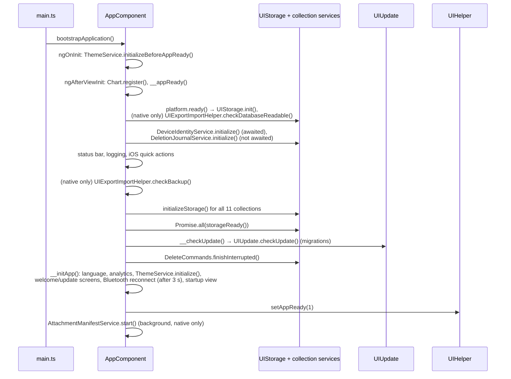
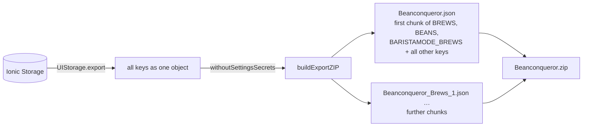
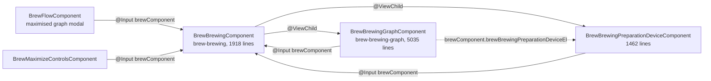

# Beanconqueror Architecture

This document describes how the app is built today, which parts are known to be
hard to change, and the rules that new code follows. Every statement names the
files it is based on; if the code and this document disagree, the code wins and
this document needs an update.

Contents:

1. [Overview](#1-overview)
2. [Data](#2-data)
3. [Devices](#3-devices)
4. [UI layer](#4-ui-layer)
5. [Known legacy areas](#5-known-legacy-areas)
6. [Target picture for new code](#6-target-picture-for-new-code)
7. [Testing rules](#7-testing-rules)

## 1. Overview

### Platform and stack

| Concern          | Choice                                                                                        | Where                                                                            |
| ---------------- | --------------------------------------------------------------------------------------------- | -------------------------------------------------------------------------------- |
| Framework        | Angular 22, standalone components, bootstrapped without NgModules                             | `package.json`, `src/main.ts`                                                    |
| Language         | TypeScript 6, with the defaults of TypeScript 5 (`strict: false`, …)                          | `tsconfig.json`                                                                  |
| UI kit           | Ionic 9, `md` mode on every platform (iOS included)                                           | `src/main.ts` (`provideIonicAngular({ mode: 'md' })`)                            |
| Native shell     | Capacitor 8 (Android, iOS), plus a few Cordova plugins (BLE, NFC)                             | `capacitor.config.ts`, `package.json`                                            |
| Storage          | Ionic Storage (IndexedDB first)                                                               | `src/main.ts`, `src/services/uiStorage.ts`                                       |
| i18n             | ngx-translate, JSON files per language                                                        | `src/main.ts`, `src/assets/i18n/`                                                |
| Charts           | Chart.js                                                                                      | `src/app/app.component.ts` (`Chart.register`)                                    |
| Change detection | zone.js (`provideZoneChangeDetection()`); existing components `ChangeDetectionStrategy.Eager` | `src/main.ts`, `src/polyfills.ts`                                                |
| Tooling          | pnpm, ESLint (with a suppressions ratchet), Prettier, Karma, Playwright                       | `package.json`, `eslint.config.mjs`, `src/karma.conf.js`, `playwright.config.ts` |

### Supported platforms

The app runs in the system WebView, so Angular's browser support sets the minimum
platform versions. Angular 22 supports the browsers that are "Baseline widely
available" on 2026-05-07: Chrome, Edge and Firefox 119+, Safari and iOS 17+.

| Platform | Minimum                                                             | Where                                                                            |
| -------- | ------------------------------------------------------------------- | -------------------------------------------------------------------------------- |
| Web      | Chrome, Edge, Firefox 119+, Safari 17+                              | `.browserslistrc`                                                                |
| iOS      | iOS 17.0 (WKWebView is Safari of the same version)                  | `IPHONEOS_DEPLOYMENT_TARGET` in `ios/App/App.xcodeproj`, `ios/App/Podfile`       |
| Android  | Android 8.0 (`minSdkVersion = 26`) with Android System WebView 119+ | `android/variables.gradle`, `android.minWebViewVersion` in `capacitor.config.ts` |

On Android the WebView is updated through Google Play independently of the
system: Android 8 and 9 get WebView versions up to 138, Android 10 and later the
current one. A device that never updated its WebView can still be below 119.
Capacitor then loads `server.errorPath` (`src/assets/webview-unsupported.html`)
instead of the app; the page asks, in English or German, to update Android System
WebView in Google Play. The same page appears if the app page fails to load, then
with a retry link.

### Start sequence

`src/main.ts` registers the providers (storage driver order, router, translations
with `en` as default and fallback, Ionic in `md` mode, the global
`BeanconquerorErrorHandler`) and bootstraps `AppComponent`
(`src/app/app.component.ts`). The component then runs the following steps:



Routes wait for this: every top-level route carries the `appReady` resolver,
which resolves once `UIHelper.isBeanconqurorAppReady()` sees the ready flag
(`src/app/app.routes.ts`, `src/services/uiHelper.ts`). Code that runs outside a
route (services, quick actions) waits on the same promise.

If one collection fails to load, the app shows a blocking error message
(`UIAlert.showAppShetItSelfMessage()` in `__appReady`). A collection that
could not be read counts as failed to load, not as empty (see "Storage
layer").

### Routing and navigation

```
/                         → redirect to /home/dashboard
/home                     HomePage (eager), ion-tabs with four tabs
  /home/dashboard         Home
  /home/brews             Brews
  /home/beans             Beans
  /home/profile           Profile hub
  /home/profile/preparations   preparation methods (in the profile tab's stack)
  /home/profile/mills          grinders (in the profile tab's stack)
  /home/preparations, /home/mills   redirects kept for old links
/settings, /statistic, /water-section, /roasting-section, /graph-section,
/helper, /info, /brew-parameter, /bean-parameter, /baristamode   (lazy)
```

- Tabs: `src/app/home/home.page.html`, child routes in `src/app/home/home.routes.ts`.
- Top-level routes are lazy (`loadComponent`/`loadChildren`) except `/home`
  (`src/app/app.routes.ts`).
- There is no side menu. The profile tab (`src/app/profile/profile.page.*`) is
  the hub for everything that is not a tab of its own, in three groups:
  equipment (preparation methods, grinders, water, barista mode), sections
  (statistics, brew and bean parameters, calculations, graphs, roasting) and
  app (settings, info). Water, graphs and roasting are listed only while they
  are switched on in the settings, the barista mode only while an active
  Sanremo YOU preparation method exists. The legal pages (Impressum, privacy)
  and the community links sit at the bottom of the hub.
- Pages outside the tabs keep their top-level paths and have a back button
  (`ion-back-button` with `defaultHref="/home/profile"`); tab pages have no
  button on the left. The Android back key pops the page, and on a page without
  history it leads to the profile (`AppComponent.__registerBack()`).
- Most create, edit and detail screens are modals opened through helper services
  (for example `src/services/uiBrewHelper.ts`, `src/services/uiBeanHelper.ts`),
  not routes.

### Folder structure

| Folder                         | Content                                                                                       |
| ------------------------------ | --------------------------------------------------------------------------------------------- |
| `src/app/`                     | Pages and the components that belong to one page (e.g. `src/app/brew/brew-add/`)              |
| `src/components/`              | Components shared between pages (cards, brew form parts, header, timer)                       |
| `src/popover/`                 | Popovers and small modals (welcome, update, loading, device chooser)                          |
| `src/classes/`                 | Data model classes (`Bean`, `Brew`, `Settings`, …), device drivers, `StorageClass`            |
| `src/classes/changeTracking/`  | Change info of stored entries, attachment references, local-only storage keys (no Angular)    |
| `src/interfaces/`              | `I*` interfaces of the stored data model                                                      |
| `src/enums/`                   | Enums used by the data model and the UI                                                       |
| `src/services/`                | Storage services (`ui*Storage.ts`), helpers (`ui*Helper.ts`), platform and feature services   |
| `src/brew-session/rules/`      | Rules of the brew views in plain TypeScript (`brewFieldLayout.ts`: which fields, which order) |
| `src/stores/`                  | Signal stores for new code, one per collection, reading on top of `StorageClass`              |
| `src/pipes/`, `src/directive/` | Pipes and directives                                                                          |
| `src/data/`                    | Static data (cupping flavors, default graph colors, tracking names)                           |
| `src/theme/`                   | Global theme: `variables.scss` (Ionic palette), `bq-tokens.scss` (design tokens)              |
| `src/native/`                  | Typed bridges to the app's own native plugins                                                 |
| `src/generated/`               | Generated code (icon registry, protobuf); do not edit by hand                                 |
| `src/test-utils/`              | Shared helpers and mocks for unit tests                                                       |
| `e2e/`                         | Playwright tests, fixtures and the axe baseline                                               |
| `tools/`                       | Build and release scripts                                                                     |

### Conventions

- Component and directive selectors use the `app` prefix (`eslint.config.mjs`);
  older code does not always follow it, which is why the rule is a warning.
- ESLint errors that already existed are recorded in `eslint-suppressions.json`;
  the file may only shrink (`DEVELOPING.md`).
- Formatting and import order come from Prettier (`package.json`, `prettier`),
  run on staged files by lint-staged.
- Unit tests live in a `__tests__` folder next to the code they test
  (e.g. `src/classes/settings/__tests__/`) or, in the newer service folders,
  as `*.spec.ts` beside the file
  (e.g. `src/services/deviceIdentity/device-identity.service.spec.ts`).
- Services are declared with `@Service()` (Angular 22; automatically provided like
  `@Injectable({ providedIn: 'root' })`), and dependencies are injected with
  `inject()`. Several legacy services also expose
  a static `instance` or `getInstance()` for code that cannot inject
  (e.g. `src/services/uiBeanStorage.ts`, `src/services/uiAlert.ts`).

## 2. Data

### Storage layer

```
Component / helper service
        │
        ▼
UIBeanStorage, UIBrewStorage, …      (src/services/ui*Storage.ts)
        │  extends
        ▼
StorageClass                         (src/classes/storageClass.ts)
   in-memory array of all entries, add/update/remove, change info, events
        │
        ▼
UIStorage                            (src/services/uiStorage.ts)
   get/set by key with retries, export/import, STORAGE_CHANGED event
        │
        ▼
@ionic/storage  ─ driver order: IndexedDB → localStorage   (src/main.ts)
   database name "__baristaDB"
```

- Each collection is **one key** that holds **one array** with all its entries.
  `StorageClass` loads the array once at start (`__initializeStorage`) and keeps
  it in memory; every `add`, `update` and `remove` writes the whole array back
  (`__save` → `UIStorage.set(DB_PATH, storedData)`).
- New entries get `config.uuid` (`crypto.randomUUID()`) and
  `config.unix_timestamp` in `StorageClass.addAndConfirm`.
- `StorageClass.attachOnEvent()` emits `ADD`, `UPDATE`, `DELETE` and
  `REINITIALIZE`; `ADD` and `UPDATE` of a single entry carry its `uuid`.
  `attachOnRemove()` emits the id of a deleted entry. Services that cache
  class instances (e.g. `UIBeanStorage.getAllEntries()` builds `Bean` objects
  with `initializeByObject`) clear the cache on every event.
- `getRawEntries()` returns the stored array itself, without the class
  instances of the typed storages. It exists for the stores (see below) and
  is read-only.
- `UIStorage.set` and `UIStorage.get` retry up to 20 times, reconnect the
  database after 11 failed attempts and finally show the iOS database error
  dialog. A successful `set` dispatches `AppEventType.STORAGE_CHANGED`
  on the `EventQueueService`.
- A database that could not be read is never taken for an empty one:
  - `UIStorage.get` resolves `null` for a missing value and for a failed read
    alike. Code that writes depending on what it read uses
    `UIStorage.getOrFail`, which rejects when the read failed.
  - `StorageClass.__initializeStorage` reads with `getOrFail`. When that
    fails, `initializeStorage()` and `storageReady()` reject and the
    collection refuses `add`, `update`, `remove` and `backfillWithoutTouch`
    (logged, no event) until a later `reinitializeStorage()` has read it. The same holds while it is
    being read and before it was read for the first time. Every write stores
    the whole array, so a write on a list that was not read would replace
    the stored entries.
  - After an import, `SettingsPage.__reinitializeStorages` reads every
    collection again, also after one that could not be read, and then
    rejects naming those. A collection left with the entries from before
    the import would store them over the imported ones with its next write.
  - `UIStorage.getDataState()` tells whether the database holds data of a
    used installation: `'data'`, `'empty'` or `'unknown'` when it could not
    be read. It reads with the attempts of `get` (reconnecting after 11),
    but shows no dialog itself. `checkDatabaseReadable`, `checkBackup` and
    `saveAutomaticBackups` neither import nor write a backup for
    `'unknown'`.
  - The first refused write of a session tells the user that the change was
    not saved and to start the app again (`STORAGE_NOT_READ_NOTHING_SAVED`);
    the details are only logged.

### Change info in the write path

Entries of the collections in `CHANGE_TRACKED_COLLECTIONS`
(`src/classes/changeTracking/changeTracking.ts`: all collections except
`SETTINGS` and `VERSION`) carry change info in their `config`
(`src/interfaces/objectConfig/iObjectConfig.ts`): `created_at` and
`updated_at` in milliseconds, a revision counter `rev` and `updated_by`, the
device id of the installation that wrote the entry last. `unix_timestamp`
keeps its meaning (for brews the brew time the user can edit). The model
classes do not initialize these fields; `StorageClass` sets them when it
writes:

- `addAndConfirm` stamps a new entry (`stampAdded`: `rev` 1, both times now).
- `update` counts as a change by this device (`stampUpdated`: `updated_at`,
  `rev` + 1, `updated_by`). It stores a copy of the caller's object, so later
  unsaved changes to that object cannot reach the disk with another write.
- `update(entry, { touch: false })` is the system write path for migrations
  and other maintenance: it keeps the stored change info.
  `backfillWithoutTouch()` does the same for a whole collection with one save.
- A deletion removes the entry at once and then records a note (collection,
  uuid, time, device id, last `rev`) in the deletion journal
  (`src/services/deletionJournal/deletion-journal.service.ts`). Notes of
  entries that exist again, for example after an import, are dropped when the
  collection loads.
- The writes of one collection run one after the other
  (`StorageClass.__inTurn`): each changes the entries in memory, saves the
  whole collection and takes its change back when the save failed, before
  the next write starts. So no write is saved or taken back together with
  another one. A write must therefore never wait for another write of its
  own collection from inside (it would wait for itself); events are sent
  without waiting for their subscribers.
- A single write whose save fails is taken back like one of `applyChanges`
  below: an added entry is gone (`addAndConfirm` resolves `saved: false` and
  what would have been stored, `add` only the latter), an updated entry is
  the object from before, a deleted one is back at its place. The entry event
  (`ADD`, `UPDATE` with `uuid`), `DELETE`, `attachOnRemove()` and the deletion
  note follow only a successful save; after a failed one a bare `UPDATE` lets
  the caches drop their objects. So the objects a failed write put into
  memory do not reach the disk with the next save of the collection.
  - Not covered: the typed objects (`initializeByObject` is `Object.assign`)
    share their nested arrays and objects with the stored entry. What a
    caller changes inside them before `update()` is already in the stored
    entry and stays there after a failed save; the next save of the
    collection stores it without new change info. Callers that change
    nested values work on a copy with a list of its own, as the tool dialog
    of a preparation does (`preparation-edit-tool.component.ts`).
  - A caller of `add` that goes on without the answer works with an entry
    that is not stored. Whatever follows the add (files named after the
    entry, changes to other entries, a toast) uses `addAndConfirm`. The
    standard mill after an import (`settings.page.ts`) stops at the first
    write that was not stored and only logs it; the collection reports it.
- Settings and version hold one entry that the storage creates itself. When
  that could not be saved, `saveSettings()`/`saveVersion()` store it with the
  next call (`StorageClass.storeOnlyEntry`).
- The forms that add or edit a bean, green bean, mill, preparation, water or
  roasting machine, the forms that add or edit a brew, the form that adds a
  graph and the tool dialog of a preparation save through `storedOrReported()`
  (`src/classes/storedOrReported.ts`). Only when the entry was stored they
  show their toast, delete the files of removed photos and close. Otherwise
  the form stays open with what was entered and the user gets one message:
  the one of the collection, or `STORAGE_SAVE_FAILED` from the form when it
  stayed silent. A brew form keeps the uuid of its brew for the next try, so
  the flow profile files are written again under the same names.
- `applyChanges({ update, remove, add })` is the one way to write several
  entries of a collection with a single save: it replaces, removes and adds,
  in this order, and stores all of it or nothing. `updateMany(entries)`,
  `addMany(entries)` and `removeManyByUUID(uuids)` are this call with one
  kind of change. Each entry is stamped by the code that stamps a single
  `update` or `add`, so its change info is the same as on the single way.
  - `updateStored` takes entries in their stored form (`getRawEntries()`).
    They replace the stored ones like `update`, but are not prepared for
    storage (`prepareEntryForStorage`, for a brew `fixDataTypes()`), so
    nothing of them changes but the change info. It is for maintenance that
    must not normalise old entries on the way.
  - Nothing is changed and `saved` is false while the collection takes no
    writes, when an entry to update is not stored or cannot be prepared, and
    when the save fails. After a failed save every change is taken back by
    itself (replaced entries are the objects from before, added ones are
    gone, removed ones are back at their places). Objects the caller changed
    before the call stay
    changed; callers hand over changed copies or assign new values instead of
    changing nested values of a typed entry, which it shares with the stored
    one.
  - Events and deletion notes follow the save. The call sends one event:
    `DELETE` when it only removed, otherwise `ADD` (only added) or `UPDATE`
    with `uuids`, the replaced and added entries. The attachment manifest
    checks the files of each of them; caches keyed by one `uuid` are dropped
    as a whole. Removed entries are still announced one by one through
    `attachOnRemove()` and get their notes with one journal write.
  - The collection shows at most one message of its own for the call (a
    refused write once per session, a failed save once).
    `StorageClass.getMessagesShown()` tells a caller whether it did, so the
    caller shows its own message only when the collection stayed silent.
- Freezing a bean into bags (`bean-popover-freeze`) is one `applyChanges`:
  all bags are added and the bean they are taken from is reduced, emptied or
  removed with the same save. A bean that the bags use up and that has no
  brews is asked about before anything is stored. The photos of the bags
  are copied before the save and deleted again when it fails. After a
  failure nothing is frozen and the bean of the dialog is the one from
  before, as `BEAN_FREEZE_NOTHING_FROZEN` tells the user; the dialog stays
  open for another try. That message is shown also when the collection has
  reported the failed save itself. Unfreezing a part of a bag
  (`bean-popover-unfreeze`) is one `applyChanges` as well: the part is added
  and the bag gets its group and loses the weight of the part with the same
  save. When that fails, or a photo cannot be copied, the copies are deleted,
  the bean of the dialog is the one from before, the user gets one message
  (`storedOrReported()`) and the dialog stays open; unfreezing the whole bag
  does the same with its single write. Marking a best brew
  (`brew-information`) saves the brew and the one that loses the mark with
  one `updateMany`. The Excel import (`uiExcel.ts`) stores the beans of a
  file with one `addMany`: all of them or none, so no import is partly
  stored, and it shows its own message only when the collection stayed
  silent.
- `removeManyByUUID(uuids)` removes several entries with one save, one
  `DELETE` event and one journal write. `DeleteCommands`
  (`src/stores/delete-commands.ts`) deletes with it what takes other entries
  along: a bean, a mill or a preparation with its brews, and a green bean with
  the beans roasted from it and their brews. After checking that the entry
  exists and all collections take writes, each collection is saved once, the
  brews first and the entry last. A command resolves false when nothing or
  not all was deleted, and the card then shows a message instead of the
  toast. A water and a roasting machine take nothing along. Their cards
  (`water-information-card`, `roasting-machine-information-card`) first
  check that the collection of the entry takes writes, take the entry out
  of all brews or beans naming it with one `updateMany`, then remove it.
  Brews or beans that could not be saved keep naming it, in memory as well,
  since the cards hand over changed copies. Only when the entry cannot be
  removed after they were saved, it is left with nothing naming it and can
  be deleted again. The cards show `ERROR_OCCURED` unless a collection has
  reported the failure. Deleting a tool of a preparation
  (`preparation-edit-tool`) works the same way: one save of the brews, then
  one of the preparation, and the dialog stays open when one of them fails.
  - A refused write changes nothing. A save that fails for good ends in the
    iOS database dialog of `UIStorage.set`, which only reloads the app: the
    save does not return, the stored entries are the ones from before. Only
    if that dialog cannot be shown the save returns false; the removed
    entries are then put back in memory and nothing is reported as removed.
  - The saves are not one transaction. When the app stops between them, or
    a collection cannot be saved after the one before, the entry is left
    without the entries deleted until then and can be deleted again; when it
    stops before the journal write, the notes of that save are missing.
  - A write of the same collection that succeeds while such a save fails
    stores the collection without the removed entries; they are stored again
    with its next write. When the app stops before, they are gone without a
    note.
  - A collection that is read anew while the save runs, for example by an
    import, is not compared after a successful save, as when a single entry
    is deleted: the entries are reported as removed although the entries
    read may hold them. No note is written for those, and the next write of
    the collection stores them again.
  - The collection reports a refused write and a failed save with messages
    of its own, so the message of the card can be the second or third one on
    the screen.
- While a command deletes, the local-only key `PENDING_DELETION` holds the
  collection and uuid of the entry and the time it started, nothing about
  the dependent entries. It is written after the checks and before the first
  save; if it cannot be written, nothing is deleted and the command resolves
  false. The dependent entries are looked up again after it was written, so
  no other write lies between looking them up and the first save. It is
  removed as soon as the command returns, whatever the result, with up to
  three attempts in a row. It is only left when the app ends in between,
  stays in the database dialog or all three attempts fail. The next start
  then calls `DeleteCommands.finishInterrupted()` once, after all
  collections were read and after the data updates:
  - The note is removed first, so it is acted on at most once. If it cannot
    be removed, nothing else happens.
  - It only goes forward. The entry is deleted, with its journal note, when
    it still exists and no stored entry depends on it. Dependent entries are
    never deleted at start: while one is left, nothing happens and the entry
    stays as it is, to be deleted again by the user. No missing journal
    notes are added.
  - Nothing is deleted when a backup was imported since the note was
    written (`LAST_RESTORE`), when restoring the internal backup was begun
    at this start and not completed
    (`UIExportImportHelper.restoreAtStartFailed()`), when the note is
    invalid, lies in the future or is older than 24 hours
    (`PENDING_DELETION_MAX_AGE_MS`: an interruption is noticed at the next
    start, an older note is one that was left behind), or when one of the
    two notes cannot be read. Every `UIStorage.import()` removes the note before anything else,
    also an import that fails.
  - It shows nothing itself and only logs; only reading the two notes can
    end in the database dialog of `UIStorage`. What it does not do:
    - On a device the check of the internal backup runs before it. After
      an interrupted deletion that check usually finds more entries in
      `Beanconqueror.zip` than in the database and shows its dialog first.
      Restoring puts everything back and nothing is finished; only when the
      restore is declined, or in the browser, the entry is deleted.
    - It does not bring back the dependent entries already deleted, and it
      does not delete the remaining ones.
    - Of two stored entries sharing the uuid, the second one is deleted when
      the app ended after the first one was saved as deleted.
    - A note that could not be removed stays until the next start, the next
      of these deletions or the next import removes it. After 24 hours it is
      only removed and nothing is deleted for it.
    - It cannot tell a command that returned from one that did not. When a
      command resolved false, the user was shown the error and the note
      could not be removed, a start within 24 hours still deletes the entry
      if nothing depends on it.
    - The three attempts to remove the note follow each other without a
      pause, so they cover a single failure, not a database that is away
      for a moment.
    - The 24 hours are measured with the device clock. With the clock set
      back to a time within 24 hours after the note was written, an older
      note counts as fresh.

Entries from before change tracking have `updated_at` 0, `rev` 0 and
`updated_by` `''` ("unknown") and a `created_at` estimated from
`unix_timestamp`; `fillMissingChangeInfo()` fills these in and never changes a
value that is already there.

The device id comes from `DeviceIdentityService`
(`src/services/deviceIdentity/device-identity.service.ts`), a random value
created on first start; it is initialized before the collections load. Backups
made by the operating system copy the database and with it the device id (see
the comment in that file).

### Local-only keys

More storage keys belong to exactly one installation
(`LOCAL_ONLY_STORAGE_KEYS` in `src/classes/changeTracking/localStorageKeys.ts`):

| Storage key           | Service                                                          | Content                                           |
| --------------------- | ---------------------------------------------------------------- | ------------------------------------------------- |
| `DEVICE`              | `src/services/deviceIdentity/device-identity.service.ts`         | Device id of this installation                    |
| `DELETION_JOURNAL`    | `src/services/deletionJournal/deletion-journal.service.ts`       | Notes about entries deleted here                  |
| `ATTACHMENT_MANIFEST` | `src/services/attachmentManifest/attachment-manifest.service.ts` | Photo and flow profile files the entries refer to |
| `LAST_RESTORE`        | `src/services/uiStorage.ts`                                      | Note about the last import                        |
| `PENDING_DELETION`    | `src/stores/delete-commands.ts`                                  | Entry being deleted with its dependents           |

They are not collections of entries and do not extend `StorageClass`. They
never go into a backup or export file, an import never overwrites them with
values of a file (it writes its own `LAST_RESTORE` and removes
`PENDING_DELETION`), and writing them does not dispatch `STORAGE_CHANGED`, so it triggers no automatic
backup (`UIStorage.internalSet`, `UIStorage.__importBackup`,
`UIExportImportHelper.buildExportZIP`).

### Collections

| Storage key         | Service                                    | Model class                                        |
| ------------------- | ------------------------------------------ | -------------------------------------------------- |
| `BEANS`             | `src/services/uiBeanStorage.ts`            | `src/classes/bean/bean.ts`                         |
| `BREWS`             | `src/services/uiBrewStorage.ts`            | `src/classes/brew/brew.ts`                         |
| `PREPARATION`       | `src/services/uiPreparationStorage.ts`     | `src/classes/preparation/preparation.ts`           |
| `MILL`              | `src/services/uiMillStorage.ts`            | `src/classes/mill/mill.ts`                         |
| `GREEN_BEANS`       | `src/services/uiGreenBeanStorage.ts`       | `src/classes/green-bean/green-bean.ts`             |
| `ROASTING_MACHINES` | `src/services/uiRoastingMachineStorage.ts` | `src/classes/roasting-machine/roasting-machine.ts` |
| `WATER`             | `src/services/uiWaterStorage.ts`           | `src/classes/water/water.ts`                       |
| `GRAPH`             | `src/services/uiGraphStorage.service.ts`   | `src/classes/graph/graph.ts`                       |
| `BARISTAMODE_BREWS` | `src/services/uiBaristamodeBrewStorage.ts` | `src/classes/brew/baristamodeBrew.ts`              |
| `SETTINGS`          | `src/services/uiSettingsStorage.ts`        | `src/classes/settings/settings.ts`                 |
| `VERSION`           | `src/services/uiVersionStorage.ts`         | `src/classes/version/` (applied migrations)        |

Most collections have a matching `ui*Helper.ts` service that opens the add,
edit and detail modals and holds shared logic (e.g. `src/services/uiBrewHelper.ts`).

The stored shape is part of the backup format: older backups are imported as
they are and migrated on the next start (see below), so fields are not renamed
or removed.

### Settings

`SETTINGS` holds exactly one entry. `UISettingsStorage` creates it on first
start and returns it as a `Settings` instance through `getSettings()`
(`src/services/uiSettingsStorage.ts`, `src/classes/settings/settings.ts`).
`Settings.user` is the user profile (`src/interfaces/settings/iUserProfile.ts`);
new installations start in the beginner mode, stored settings without a
profile load with the advanced mode (`Settings.normalizeUserProfile`).
Settings that hold credentials are listed in
`src/classes/settings/settingsSecrets.ts` (see backups).

### Stores (reading)

New code reads a collection through a store in `src/stores/`, not through the
`ui*Storage` services. `StorageClass` stays the source of truth: a store keeps
nothing on disk and only reads; writes still go through the `ui*Storage`
services and come back to the store as events. `BeanStore`
(`src/stores/beans/bean.store.ts`) is the first store; the bean list
(`src/app/beans/beans.page.ts`) and the bean card
(`src/components/bean-information/`) read it.

```
legacy code ──▶ UIBeanStorage (StorageClass) ──▶ UIStorage
                      │  getRawEntries(), attachOnEvent(), storageReady()
                      ▼
new code ◀─signal── CollectionStore      entries
```

- `CollectionStore` (`src/stores/core/collection-store.ts`) knows a
  collection only through `StoreSource`, the three methods above.
- Every event of the collection, whatever its type and whoever wrote, makes
  the next read compare all stored entries with the previous ones by their
  `JSON.stringify` text. An entry whose text is known keeps its object, so
  `===` tells whether an entry changed; several events before a read cost one
  comparison. A change that legacy code makes in place, without saving, shows
  up with the next event of the collection, which is also when it reaches the
  disk.
- Entries are plain data, typed `DeepReadonly<T>` and, in dev mode only, deep
  frozen (`src/stores/core/read-only.ts`). A bean passes through `new Bean()`
  and `initializeByObject`, so it has the same defaults as the instances of
  `UIBeanStorage.getAllEntries()`, but none of the methods. Store objects and
  legacy objects are never shared: the bean list hands its cards copies made
  by the sort helper.
- Until the collection has been read, `entries()` is empty.
- A stored entry that is no object (a broken record) is left out and stays in
  the storage unchanged; the store logs how many it skipped, not the entries.
- `changes` repeats the events of the collection for legacy code that has to
  act before a view shows a change (the bean list saves its scroll position).
- Brews have no store with copies: `BeanUsageStore`
  (`src/stores/beans/bean-usage.store.ts`) reads the stored brews once after
  each change and gives brew count, grams used and last brew per bean, by the
  rule of `src/services/beanUsage/used-bean-weight.ts`.
  `BrewUsageStore` (`src/stores/brews/brew-usage.store.ts`) does the same per
  grinder and per preparation method for their cards: brew count, weights,
  different beans and the last brew.
- Rules on store data are pure functions with the time as a parameter
  (`src/stores/beans/bean-rules.ts`); each gives the result of the method of
  the same name on `Bean`.
- The bean card shows the stored bean with the uuid of its input, so it also
  follows changes its host has not passed on. Its actions hand the legacy
  dialogs a changeable copy (`toLegacyBean`), taken when the action starts.

### Files on the file system

Large or binary data does not live in the database but in the app's data
directory (`UIFileHelper.getDataDirectory()`: `Documents` on iOS, `Data` on
Android, `src/services/uiFileHelper.ts`). The database only stores the path.

- Photos: `attachments` arrays on beans, brews and other entries; files are
  written through `src/services/uiImage.ts` with
  `UIFileHelper.generateInternalPath()`. The edit form of a stored entry
  (`src/components/photo-add/`) changes a list of its own, so a cancelled
  form leaves the photos of the entry as they were. A photo removed there
  keeps its file until the entry was stored without it
  (`UIImage.deleteRemovedPhotos()`); when the save fails the file stays and
  the entry in memory is the one from before.
- Flow profiles (scale, pressure and temperature readings of a brew):
  `brews/<uuid>_flow_profile.json`, written by
  `src/components/brews/brew-brewing/brew-brewing.component.ts`; imported
  reference graphs live under `importedGraph/` (`Brew.getGraphPath()` in
  `src/classes/brew/brew.ts`).

`AttachmentManifestService`
(`src/services/attachmentManifest/attachment-manifest.service.ts`) keeps a
list of these files with path, size, type and owner under the local-only key
`ATTACHMENT_MANIFEST`. It is derived from the entries
(`collectAttachmentRefs` in `src/classes/changeTracking/attachmentRefs.ts`)
and the files, is built in the background after the app is ready and updated
when entries change; nothing else reads it yet. It only runs on native
platforms.

In the browser there is no data directory; `getDataDirectory()` throws and the
graph code reads bundled sample flow profiles instead (see section 3).

### Backup, export and import



- `UIExportImportHelper.buildExportZIP()` (`src/services/uiExportImportHelper.ts`)
  exports all keys except the local-only ones, empties the credential fields
  and splits `BREWS` and `BEANS`
  into chunks of 500 and `BARISTAMODE_BREWS` into chunks of 250 entries
  (`EXPORT_CHUNKING_CONFIG`). The first chunk stays in `Beanconqueror.json`.
- `getJSONFromZIPArrayBufferContent()` reads the main file and appends the
  chunk files in order.
- `UIStorage.import()` (`src/services/uiStorage.ts`) first exports the current
  data as a safety backup, then writes every imported key except the
  local-only ones. If that fails, it writes the safety backup back and removes
  the keys only the imported file brought along. Credentials
  already on the device are kept (`withDeviceSettingsSecrets`). Entries of the
  imported file that lack change info get it filled in before they are written
  (`__fillMissingChangeInfo`); values the file brings along are kept.
- Credential filter: `SETTINGS_SECRET_PATHS` in
  `src/classes/settings/settingsSecrets.ts` lists the fields (Visualizer login,
  cloud AI key, brew-by-weight webhook address and credentials). They stay in
  the file with an empty value so the format does not change. A device that
  restores a backup without a webhook of its own has the webhook switched on
  but without an address, so it is not called until one is entered.
- Automatic backups: on Android and iOS, `AndroidPlatformService` and
  `IosPlatformService` listen to `STORAGE_CHANGED` with a 3 s debounce and call
  `saveAutomaticBackups()`, which writes `Beanconqueror.zip` into the data
  directory and a dated copy under `Download/Beanconqueror_export/`; at
  start the eight newest copies are kept and older ones removed
  (`src/services/androidPlatform/android-platform.service.ts`,
  `src/services/iosPlatform/ios-platform.service.ts`).
  Both files are written under another name (`Beanconqueror.zip.part`,
  `Beanconqueror_automatic_export.zip.part`) and renamed once complete
  (`UIFileHelper.replaceFileFromBlob`), so a write the system cuts off
  leaves the file from before as it was. A `.part` file is never listed or
  counted; the next write deletes it first. The plugin renames by
  deleting the old file and moving the new one, on Android and iOS alike,
  so for that moment the file is missing. A write that fails deletes its
  `.part` file. A rename that fails deletes it only while the file from
  before is still there; when that one is gone, the complete `.part` file
  is the only one left and stays.
- An app ended in that moment, or a move that failed, leaves no
  `Beanconqueror.zip`, only the complete `Beanconqueror.zip.part`. At start
  (native only),
  `checkDatabaseReadable()` first gives that file its name
  (`__nameCompleteUnfinishedInternalBackup`), so everything after it finds
  the internal backup: only when there is no `Beanconqueror.zip`, and only
  when the file can be read as a backup the way an import reads it
  (`getJSONFromZIPArrayBufferContent`). Beside a `Beanconqueror.zip` the
  `.part` file is an older or cut off write and is left alone. A file that
  cannot be read, or that cannot be renamed, is left as it is and logged;
  the start goes on without an internal backup and the next write deletes
  the file. A move that failed leaves the same behind while the app goes
  on, so `__saveInternalBeanconquerorDump` does the same before every write:
  that write deletes the `.part` file first and would leave no internal
  backup at all if it then fails. No automatic backup is expected to write at the same time: a run
  is only started 3 s after `STORAGE_CHANGED`, which only a write to the
  database sends, and the start itself (`__appReady`) writes nothing before
  this point right after `UIStorage.init()`. No test holds this, and writes
  from elsewhere are not ruled out. The `.part` file of the dated copy is not
  taken over.
- Once `Beanconqueror.zip` has its name, `__saveInternalBackupSummary`
  writes `Beanconqueror.zip.meta.json` beside it, also under another name
  first (`.part`): a format version, the size and time of change (`mtime`)
  the file has by `stat`, and the number of beans, brews, preparations and
  grinders written into it. Copies of an entry count, so the file never
  holds more than the summary says (the check removes identical copies
  before it counts). When the summary cannot be written, or the file
  already has another size, the summary from before is deleted and the
  error is logged; the user is not told. Nothing else reads, lists, deletes
  or imports it.
- At start (native only), `checkBackup()` first reads that summary
  (`__readInternalBackupSummary`). It is used only when its version is
  known, its counts are whole numbers and `Beanconqueror.zip` has exactly
  its size and time of change; the time is needed as well, as a backup of
  the same size can follow without a new summary, when the app is ended
  before it is written or a complete `.part` file is taken over at start.
  When the database holds data and the summary holds no more beans, brews,
  preparations or grinders than the database, the check is over without
  reading the ZIP. In every other case, the same as without a summary, it
  reads a single file: the internal
  `Beanconqueror.zip` in the data directory, or the legacy `Beanconqueror.json`
  when there is no ZIP (`readBackupZIPFile`), and that file decides. Despite its name,
  `__getBiggerFileBackupOrAutomatic` compares nothing: the comparison with the
  dated copies is commented out and `isAutomaticBackup` is always `false`. In
  `checkBackupAndSeeIfDataAreCorrupted`, an empty database imports the file
  directly; otherwise the data corruption dialog offers the file when it holds
  more beans, brews, preparations or grinders than the database. When the
  database could not be read (`getDataState()` is `'unknown'`), checked right
  after `UIStorage.init()` before anything else reads it, nothing is
  imported by itself and the start does not go on: the database dialog
  (`IOS_DATABASE_ISSUE_TITLE`, `DATABASE_NOT_READ_DESCRIPTION`) asks to close
  the app and start it again, or to choose a backup in the list of
  Settings › Find and import an automatic backup file, where
  `Beanconqueror.zip` comes first. The chosen file is imported (see
  docs/backup-before-import.md) and the start goes on; otherwise the dialog
  is shown again. The internal `Beanconqueror.zip` is not replaced until
  every collection was read (`UIExportImportHelper.allCollectionsRead()`,
  called at start-up and after an import): the stored entries can be newer
  than the file, and the file is the only copy known to be readable.
  `saveAutomaticBackups()` writes no file while the database cannot be
  read.
- Photos and flow profiles are not part of the ZIP. On Android, the manual
  export in settings copies them next to it (`exportToPath` in
  `src/app/settings/settings.page.ts`) and an import from settings copies
  them back; on iOS the data directory is visible to the user. A file that
  is missing or cannot be copied is skipped and logged; after the export or
  the successful import the user is told how many (`FILES_NOT_COPIED`).

### Start migrations

`UIUpdate.checkUpdate()` (`src/services/uiUpdate.ts`) runs the data migrations
`UPDATE_1` … `UPDATE_19` in order. A migration that succeeds is recorded in the
`VERSION` entry (`Version.pushUpdatedDataVersion`) and does not run again. If
`__updateDataVersion()` returns `false` or throws, nothing is recorded and the
migration runs again on the next start (`__checkUpdateForDataVersion`); the
migrations after it do not run at this start, so they always run in order.

A migration is not recorded when one of its writes was not stored
(`__stored`): it stops at that write and runs again at the next start. That
holds for every migration that comes to the same result when it runs again
on data it changed in part. Three would not: `UPDATE_4` (iOS) moves the files
of an entry before it writes the entry, so a second run could no longer find
them; `UPDATE_5` stores the settings first and leaves out the preparations
once the settings carry the new order; `UPDATE_15` multiplies the crack times
of every bean by 60, also of beans already converted. They go on with the
other entries, only log how many writes were not stored (`__logNotStored`)
and are recorded all the same, as before. Running again also means that the
settings migrations reset filters and sorts again, `UPDATE_8` asks for the
analytics consent again and `UPDATE_6` and `UPDATE_9` set the tools and the
repeat parameters of the preparations again, also when the user changed them
between the two starts. When
`UIStorage.getDataState()` is `'empty'` and a migration is pending, a loading
spinner is shown while they run; with existing data they run without it.

`UPDATE_16` fills in the change info of all stored entries and stores the user
profile of existing installations
(`src/services/changeTracking/change-tracking-migration.service.ts`). It writes
each collection once and is only recorded when everything was stored.

`UPDATE_17` cleans up entries that share a uuid
(`src/services/changeTracking/duplicate-entries-migration.service.ts`, rules in
`src/classes/changeTracking/duplicateEntries.ts`): copies equal to the first
entry are removed, differing copies are kept. An imported backup is cleaned up
the same way.

A differing copy that nothing depends on becomes an entry of its own with a
new uuid. That uuid is not random but derived (`deriveNewUuids`), so two
devices that clean up the same data, at start or by importing the same backup,
give the same copy the same uuid and a later sync does not take it for two
entries:

- It is the SHA-256 (Web Crypto) of the collection, the entry and a counter,
  written as a version 8 uuid (RFC 9562). The entry goes in as JSON writes it,
  so as a backup file holds it, with sorted keys: the stored order of the keys
  plays no part. Its `config.uuid`, the shared uuid, is part of it.
- The change info (`created_at`, `updated_at`, `rev`, `updated_by`) is left
  out. An import cleans up before the change info is filled in, `UPDATE_17`
  runs after `UPDATE_16` filled it in, and entries changed since carry the id
  of the device. Everything else in the entry goes in.
- The first entry in the stored order keeps the shared uuid, as before: it is
  the one every reference finds and every change is stored into. The order is
  part of the data and is the same after a backup and its import.
- A derived uuid that the collection already holds, or that another copy got
  in the same run, is derived again with the next counter value. The cleanup
  refuses a uuid that is taken and then changes nothing in that collection.
- Devices only get the same uuids from the same entries. A backup of an older
  app version is cleaned up before the later data updates changed its entries
  and can so get other uuids than a device that ran those updates first.

`UPDATE_18` takes preparation tools out of the brews they do not belong to
(`BrewReferencesService.removeForeignTools()` in
`src/services/brewReferences/brew-references.service.ts`). A tool belongs to
one preparation: a brew keeps only the tools in the tool list of its own
preparation, archived ones included. A brew whose preparation is not stored
stays as it is, and so do brews that share a uuid, because a brew is replaced
by its uuid; they are counted in the log and the update is recorded as done
all the same, otherwise it would run at every start. A preparation stored
without a tool list has no tools, so its brews lose all of theirs. The brew
filters of the settings (`brew_filter.OPEN` and `.ARCHIVED`) lose the tools
that no preparation has; the filter of the graph reference chooser is not
stored. Barista mode brews carry no tools.

- It reads the stored entries (`getRawEntries()`) and builds no `Brew`
  objects. A changed brew is the stored entry with another tool list, written
  with `applyChanges({ updateStored })`: missing fields are not filled in
  and numbers kept as text are not converted, as a normal save of a brew
  would do. All of them are stored with one save, and unlike the migrations
  before they count as changed by this device (`rev`, `updated_at`,
  `updated_by`) so a sync passes them on. Brews that stay as they are are
  not touched.
- It runs only when `BREWS` and `PREPARATION` are read
  (`StorageClass.isRead()`); with a collection that is not read every tool
  would look foreign. Then, and when the brews or the settings could not be
  saved, nothing is recorded and the next start runs it again. After a
  failed save the brews and the filters are the ones from before.
- It runs on every backup imported in the settings as well: after such an
  import `SettingsPage.__reinitializeStorages` calls `checkUpdate(true)`,
  which stores `UPDATE_18` as not run before the migrations run, also when
  the `VERSION` entry of the backup lists it. A run that fails after an
  import is therefore repeated at the next start. A backup restored at the
  start (`checkBackup()`, the backup chosen for a database that could not be
  read) is imported before `checkUpdate()` and goes by its `VERSION` entry
  alone.
- Its log line carries numbers only (brews, changed, without preparation,
  left because they share a uuid, tools removed from the filters).

`UPDATE_1` adds the grinder "Standard" when there are brews but no grinder
and points every brew at it (`BrewReferencesService.addStandardMill()`); an
import in the settings does the same afterwards
(`SettingsPage.__addStandardMillAfterImport`). Up to now both stored the brews
with an empty grinder instead of its uuid: `add()` stores a copy, and the uuid
was read from the object passed in. The brews are now written first, in one
save and without touching their change info, with the uuid the grinder then
gets (`StorageAddOptions.uuid`). When the grinder is not stored there is still
no grinder, and the next run points the brews at a new one; a grinder stored
first would end every later run before the brews point at it. It only runs
when brews and grinders are read.

`UPDATE_19` repairs what the old code left
(`BrewReferencesService.repairStandardMill()`, rules in
`src/services/brewReferences/standard-mill.ts`). A brew is pointed at the
grinder "Standard" when there is exactly one grinder with that name, the brew
has an empty grinder (`''`), was created (`config.unix_timestamp`) no later
than that grinder, was not added later (`config.created_at`, set by the app
since change tracking and filled in from `unix_timestamp` for older brews)
and was not handed over from another app (`customInformation.imported`,
stored without a grinder when none matches). The brew form offers no empty
grinder. One other brew can have one: a quick repeat of a brew whose grinder
is archived. When its date was then set back to before the grinder
"Standard" was added, its `created_at` leaves it out; added before change
tracking it has none of its own, and it is pointed at "Standard" as well.
That is accepted: the user can choose another grinder for it. With no or
several grinders "Standard" (renamed, or one of the user's own), nothing
changes. The brews are stored with one save (`backfillWithoutTouch()`) and
keep their change info; it only runs when brews and grinders are read, and
is not recorded when the save failed. A second run finds nothing more to
change. The log line carries numbers only (brews, repaired, grinders named
"Standard").

#### Backup before `UPDATE_16` and every later update

Before the first open update from `UPDATE_16` on runs, `checkUpdate()` writes
the current data into a backup file, once for all of them
(`UIExportImportHelper.writeBackupBeforeMigration()`). Which updates get the
backup follows from their number (`isBackedUpBefore()` in
`src/services/dataUpdates/data-update-rules.ts`), so a new update cannot run
without it. The content is that of the backup before an import, the file is
its own: `pre-import/Beanconqueror_pre_migration_<first open update>_<UTC>.zip`
(`PreImportBackupService.writeBeforeMigration()`). It is listed with the
backups to import as "Data before the update to 9.0", can be shared from
there like every backup in that list, and is never deleted by the app: the
rotation after an import (`removeOldBackups`) only deletes the backups before
an import. When a file for the same first open update is there already, from
a start whose updates did not finish, no other is written, so failing starts
do not fill the storage. It is written under a name ending in `.part` and
renamed when complete, so a full storage leaves no backup that looks complete.

When it cannot be written, none of the updates runs, an alert says so and
asks to check the free storage (`MIGRATION_BACKUP_FAILED`), and none is
recorded; they run again, with the backup, at the next start. In the browser
no file is written and the updates run (as an import does). No backup is
written for an empty database (`getDataState()` not `'data'`), nor when the
only open one is `UPDATE_18` opened again by an import in the settings: the
imported file holds that data, and the data before the import was backed up
already. When `getDataState()` is `'unknown'` (the database could not be
read), neither the backup nor an update runs at that start.

When the same update stays open at two starts in a row, the user is told
once that the data from before it is backed up, with the choice to share the
logs (`DATA_UPDATE_FAILED`). The count is stored under `FAILED_DATA_UPDATE`,
a key of this installation only that is never exported
(`LOCAL_ONLY_STORAGE_KEYS`); the rules are `nextFailedDataUpdate()` and
`showsFailedDataUpdateHint()`.

The backup runs during the start, before the home screen. On a Pixel 2 XL
(debug build, 30,000 brews, three cold starts each) the home screen showed
after about 6.4 s with the `UPDATE_19` repair and the backup (2.7 MB) and
after about 2.5 s on the starts after it. That is paid once per installation
with data, and on every start while the backup cannot be written.

At every start, after the migrations, `logMissingReferences()` of the same
service writes one log line with the number of brews that refer to a bean, a
grinder or a preparation that is not stored. It changes nothing, reads the
stored entries once, logs no uuids or names and counts only when all four
collections are read.

A new migration touches two places: `DATA_UPDATES` in
`src/services/dataUpdates/data-update-rules.ts` and a new `case` in
`__updateDataVersion()` of `src/services/uiUpdate.ts`. It changes no files
(see "Data updates change no files" in DEVELOPING.md). It writes entries with `{ touch: false }` (or
`backfillWithoutTouch()`), so a migration does not count as a change by the
user; `UPDATE_18` is the exception described above. It reads the answer of
every write and is not recorded when one was not stored. The synthetic test data lists the migrations it counts as applied
(`APPLIED_DATA_VERSIONS` in `e2e/support/synthetic-data.ts`); add the new one
there and generate what it would have written, otherwise
`src/test-utils/__tests__/synthetic-data.spec.ts` fails. Existing migrations
are not changed, because installations and imported backups can be at any
older state.

## 3. Devices

### Bluetooth

`CoffeeBluetoothDevicesService`
(`src/services/coffeeBluetoothDevices/coffee-bluetooth-devices.service.ts`)
wraps the Cordova plugin `cordova-plugin-ble-central` (global `ble`). It scans,
connects, reconnects and holds at most one device per type:

| Type (`BluetoothTypes`) | Drivers                                                         | Factory                     |
| ----------------------- | --------------------------------------------------------------- | --------------------------- |
| `SCALE`                 | 21 scales (`ScaleType`), e.g. Acaia, Decent, Felicita, Timemore | `makeDevice()`              |
| `PRESSURE`              | 5 sensors (`PressureType`)                                      | `makePressureDevice()`      |
| `TEMPERATURE`           | 13 thermometers (`TemperatureType`)                             | `makeTemperatureDevice()`   |
| `TDS`                   | DiFluid R2 refractometer (`RefractometerType`)                  | `makeRefractometerDevice()` |

Types and factories: `src/classes/devices/types.ts`, `src/classes/devices/index.ts`;
one driver class per device in `src/classes/devices/`. The ids of the paired
devices are settings (`scale_id`, `pressure_id`, `temperature_id`,
`refractometer_id`); `AppComponent.__initApp()` reconnects them three seconds
after start.

### Preparation devices (machines)

A preparation method can be linked to a machine
(`Preparation.connectedPreparationDevice`, `src/classes/preparation/preparation.ts`).
`makePreparationDevice()` (`src/classes/preparationDevice/index.ts`) creates the
driver: Xenia, Meticulous, Sanremo YOU, Gaggiuino, Gaggimate (network, via
`HttpClient`) and Move2 (Bluetooth, `bluetoothPreparationDevice.ts`). The brew
form uses them through
`src/components/brews/brew-brewing-preparation-device/`; shots can also be
imported from Meticulous, Gaggiuino and Gaggimate (`src/app/brew/brew-modal-import-shot-*`).

### Barista mode

`/baristamode` (`src/app/baristamode/`) is a separate interface with barista,
brews and statistics pages (`baristamode.routes.ts`) and its own collection
`BARISTAMODE_BREWS`. The profile hub lists it once an active Sanremo YOU
preparation exists (`src/app/profile/profile.page.ts`).

### Limits in the browser

The browser build runs as Capacitor's `web` platform, so every
`platform.is('capacitor')` branch is skipped. The brew graph
(`src/components/brews/brew-brewing-graph/brew-brewing-graph.component.ts`)
then pretends a scale is connected, generates readings on a timer when the
brew timer starts and reads bundled sample flow profiles
(`src/assets/BeanconquerorFlowTestData*.json`). Real Bluetooth, NFC, camera,
file system and machine connections need a device; `DEVELOPING.md` describes
what the Playwright native boundary (`e2e/support/native.ts`) can and cannot
stand in for.

## 4. UI layer

### Ionic

Ionic standalone components are imported per component from `@ionic/angular`
(Ionic 9 no longer has the `@ionic/angular/standalone` entry point). `md` mode
is forced on all platforms, ripple is off and inputs use `useSetInputAPI` so
signal inputs work in modals (`src/main.ts`).
Custom icons are registered once in `AppComponent.addAllCustomIcons()` from
`src/generated/icon-registry.ts`.

### Design tokens

`src/theme/bq-tokens.scss` is the single source for brand values. Components
use the semantic `--bq-*` custom properties (surfaces, text, actions, borders,
focus, form controls, layout widths, type scale), never palette values. The
file maps them onto Ionic's variables at the end.

- Load order (`angular.json`, `styles`): `src/global.scss`,
  `src/theme/variables.scss` (legacy Ionic palette), `src/theme/bq-tokens.scss`,
  `src/app/app.scss`. The tokens load after `variables.scss` and win over it.
- Dark mode: `ThemeService.applyTheme()` toggles the class `ion-palette-dark`
  on `<html>` (`src/services/theme/theme.service.ts`). Ionic sets its dark
  variables on `.ion-palette-dark.md` / `.ion-palette-dark.ios`, so the token
  overrides use `:root.ion-palette-dark.md, :root.ion-palette-dark.ios` to have
  at least the same specificity; light values use `:root.md, :root.ios`.
- Call-to-action colour: `$bq-action-primary` (`--bq-action-primary`) is
  applied to Ionic's custom colour `accent` (`ionic-accent` mixin and
  `.ion-color-accent`). Ionic's built-in `primary` still comes from
  `variables.scss`.

### Accessibility

- Focus ring: `--bq-focus-ring*` tokens, applied for `:focus-visible` in
  `src/app/app.scss` (double ring on coral fills).
- Headings: `<app-header [heading]="true">` exposes the screen title as the
  level-1 heading (`src/components/header/header.component.ts`); sections below
  it use real heading elements (e.g. `h2` in `src/app/profile/profile.page.html`).
- Tabs are reachable by keyboard (`src/app/home/home.page.html`).
- Tab order follows the markup: no positive `tabindex` (the axe scan reports
  one); a button beside a field comes right after it
  (`e2e/reading-order.spec.ts`, `e2e/bean-add.spec.ts`).
- Names: a control that shows only an icon gets its name from a translated
  `aria-label` (keys under `A11Y` in `src/assets/i18n/`, or an existing key
  with the same text) and its icon is `aria-hidden`. Every `A11Y` key exists
  in English and German (`src/services/a11y/__tests__/a11y-translations.spec.ts`).
  A toggle keeps one name and tells its state with `aria-pressed`
  (`e2e/brew-list-toolbar.spec.ts`), one that shows or hides content with
  `aria-expanded` (bean group, barista graph; `e2e/bean-list.spec.ts`).
  `ion-back-button` is named through a translated `aria-label` in each header;
  Ionic reads it once when the page opens (`e2e/language.spec.ts`).
- Icons: `ion-icon` is an image to assistive technology. One that only
  decorates text next to it is `aria-hidden`; one that tells something on its
  own (favourite, frozen, best brew, a connected device) has a translated
  `aria-label`. The help icons get theirs from `TooltipDirective`
  (`src/directive/tooltip.directive.ts`).
- Overlays: `OverlayStackA11yService`
  (`src/services/a11y/overlay-stack-a11y.service.ts`, started in
  `AppComponent`) keeps only the overlay on top in the accessibility tree; the
  page and every dialog below it are `inert` and `aria-hidden` until it starts
  to close, and Tab goes round inside it. It also shows the router outlet
  again when Ionic has left it `aria-hidden` with no blocking overlay open.
  Covered by `e2e/overlay-stack-a11y.spec.ts`. The same service names the
  dialog of a modal after the `ion-title` in its header.
- Status messages: toasts and loading messages are spoken through `Announcer`
  (`src/services/a11y/announcer.service.ts`) from the one visually hidden live
  region of the Angular CDK (`LIVE_REGION` in `src/services/a11y/live-region.ts`),
  never from live regions of their own (`src/services/uiToast.ts`,
  `src/services/uiAlert.ts`). Covered by `e2e/announcements.spec.ts`.
  Info toasts stay longer while a screen reader is on (`ScreenReaderState` in
  `src/services/a11y/screen-reader-state.service.ts`).
- Spoken brew values: `TextToSpeechService` (iOS and Android) hands them to
  the screen reader while it is on, so its voice and rate apply and only one
  voice speaks: to VoiceOver through `ScreenReader.speak`, to TalkBack through
  `Announcer` (assertive). Otherwise the native
  `@capacitor-community/text-to-speech` speaks them in the app language with
  the rate and pitch from the settings (`speech-options.ts`), and
  `speechSynthesis` only in the browser. Each announcement cuts off what the
  screen reader is still reading, including the user's navigation; the time
  holds back the weight briefly (`DEVELOPING.md`).
- axe baseline: `e2e/accessibility.spec.ts` scans the main areas in light and
  dark against WCAG 2.2 AA; known violations live in
  `e2e/accessibility-baseline.json`, which may only shrink (`DEVELOPING.md`).
- `DocumentLanguageService` keeps `lang` and `dir` on `<html>` in sync with the
  app language, including right-to-left for Arabic and Hebrew
  (`src/services/documentLanguage/document-language.service.ts`).

### Typography and zoom

The type scale is in `rem` (`--bq-type-*` in `src/theme/bq-tokens.scss`), so
text follows the system text size. Inputs never go below 16 px (iOS zoom on
focus); tab labels and the screen title are capped so bar chrome does not
clip. CJK languages get system fonts first (`:root:lang(ja)` etc.). Tabular
figures are used for live readings. `e2e/typography.spec.ts` checks the layout
at 200 % text size. Stylelint (`pnpm lint`) rejects `px` for `font`, `font-size`
and `line-height` in SCSS; icon sizes and the brew and device screens are
marked as exceptions. Inline styles in templates and `px` held in SCSS
variables are outside its reach.

### Tablet column

`TabletLayoutService` (`src/services/tabletLayout/tablet-layout.service.ts`)
sets the class `bq-tablet` on `<html>` when the shortest screen side is at least
600 px (like Android's `sw600dp`). `src/app/app.scss` then limits content to
`--bq-content-max-width` (720 px) and buttons and sheets to their own maximum
widths. Covered by `e2e/tablet.spec.ts`.

### System bars and ThemeService

`ThemeService` reads `--bq-system-bar-light` / `--bq-system-bar-dark` from the
tokens and applies the colour to the `theme-color` meta tags, the status bar
(`@capacitor/status-bar`, `SystemBars`), the Android navigation and status bar
(edge-to-edge plugin) and the iOS keyboard style. The plugins are injected
through `THEME_PLUGINS` (`src/services/theme/theme-plugins.ts`) so the service
is unit-testable. `src/index.html` and the Android resources repeat the bar
colours because they cannot read CSS. Covered by `e2e/system-bars.spec.ts`.

### i18n

- One JSON file per language in `src/assets/i18n/` (22 languages), loaded over
  HTTP by `provideTranslateHttpLoader` (`src/main.ts`).
- `en` is the default and the fallback for missing keys.
- `AppComponent.__setDeviceLanguage()` picks the stored language or the device
  language on first start.
- Translations are maintained in Lokalise and arrive as "Lokalise update" pull
  requests (see the git history of `src/assets/i18n/`).

## 5. Known legacy areas

These parts have grown with the app's features. They work and are covered by
user expectations; they are listed here because changes there need extra care.
Counts were taken with `grep` over `src/**/*.ts` (without `*.spec.ts`) and
`src/**/*.html` and are approximate.

### Coupling in the brew area

The brew form and its parts reference each other directly:



- `brewComponent` is passed as `[brewComponent]='this'` from
  `src/components/brews/brew-brewing/brew-brewing.component.html` and as a modal
  prop from `brew-brewing.component.ts` and `src/app/brew/brew-detail/brew-detail.component.ts`.
- The graph component uses `this.brewComponent` 185 times, the preparation
  device component 50 times. Timer, scale events, machine shots and the form
  data therefore change together.
- The brew form behaviour is pinned by browser tests
  (`e2e/brew-journey.spec.ts`, `e2e/brew-timer.spec.ts`,
  `e2e/brew-values.spec.ts`, `e2e/brew-parameters.spec.ts`,
  `e2e/brew-quick-action.spec.ts`, `e2e/reading-order.spec.ts`) before it is
  restructured.
- First rule moved out: which fields the brew form and the brew details show,
  and in which order, is computed by `brewFieldLayout()` in
  `src/brew-session/rules/brewFieldLayout.ts` from the settings and the chosen
  preparation. Both templates render their fields in that order with `@for`
  (`brew-brewing.component.html`, `src/app/brew/brew-detail/brew-detail.component.html`),
  so the reading order of screen readers and the Tab key matches the screen;
  the CSS `order` property is no longer used for it.

### zone.js and change detection workarounds

The app depends on zone.js for change detection (`src/polyfills.ts`,
`provideZoneChangeDetection()` in `src/main.ts`); almost all state is plain
mutable fields. Counts at the time of writing:

| Pattern                                      | Occurrences           | Files |
| -------------------------------------------- | --------------------- | ----- |
| `detectChanges()`                            | 40                    | 34    |
| `markForCheck()`                             | 6                     | 2     |
| `ngZone.run(` / `zone.run(`                  | 5                     | 3     |
| `runOutsideAngular`                          | 23                    | 6     |
| `setTimeout(` (many used to defer an update) | 193                   | 79    |
| `ChangeDetectionStrategy.OnPush`             | 2 of 163 components   | 2     |
| `ChangeDetectionStrategy.Eager`              | 161 of 163 components | 161   |
| `signal(` / `computed(`                      | 25                    | 6     |

Re-count with, for example:
`grep -rE "detectChanges\(" src --include='*.ts' --exclude='*.spec.ts' | wc -l`.

Since Angular 22, `OnPush` is the default. The update migration set
`ChangeDetectionStrategy.Eager` (the former default) on every component that had no
strategy, so their behaviour did not change. ESLint reports `Eager` as an error
(`@angular-eslint/prefer-on-push-component-change-detection`); the existing components are
recorded in `eslint-suppressions.json`, so only new components fail.

Angular 22 also changed optional chaining in templates: `a?.b` now yields `undefined`
instead of `null` when `a` is missing. The update migration wrapped the existing
expressions in `$safeNavigationMigration(…)`, which keeps the old result, and turned off
the `nullishCoalescingNotNullable` and `optionalChainNotNullable` diagnostics
(`src/tsconfig.app.json`, `src/tsconfig.spec.json`). New template code does not need the
wrapper.

### Function calls in templates

About 240 call expressions in interpolations, property bindings and `@if` /
`@for` conditions across 53 of 159 component templates (all `src/**/*.html`
except `src/index.html`; heuristic `grep` for an
identifier followed by `(` inside `{{ }}`, `[x]="…"` and control-flow
conditions). With default change detection they run on every cycle. The
`brewFunction` and `beanFunction` pipes (`src/pipes/brew/brewFunction.ts`,
`src/pipes/bean/beanFunction.ts`) were introduced to move some of these calls
into pure pipes.

### Virtual lists

Long lists render only the rows near the screen. Every list (beans, brews,
the profile lists, barista mode brews and the lists in dialogs: bean chooser,
bean lists of a group and of frozen beans, brews of an entry, reference graph
chooser, shot imports) uses the building block `app-virtual-list`
(`src/components/virtual-list/`) on `@tanstack/angular-virtual`: the nearest
`ion-content` scrolls (in a dialog the dialog's), every row is measured by a
`ResizeObserver` (photos, flow graphs drawn later, opened groups, larger text,
the customizing) and its height is kept per key (`itemKey`) while the items
are rebuilt, so a reload leaves the list where it is. Content marked
`virtualListHead` (segments, search) stays at the top; a list on a page with
a floating add button ends with room for it (`clearOfAddButton`, on by
default). `scrollToKey`, `scrollToTop` and `anchor()`/`restore()` (pure
functions in `virtual-list-anchor.ts`) move it; `scrollToKey` leaves a row
that is shown and brings one cut off clear of the head and the add button. A
changed `estimateSize` keeps the measured heights (each segment its own);
`measure()` forgets them when all rows change height, as on collapsing.
`endReached` reports that the last row is rendered, for lists that load in
pages (Meticulous shot import). The rows form a list for screen readers
(`role="list"`, each row `listitem` with `aria-setsize`/`aria-posinset` of all
items). The host is marked `data-virtual-list` for the tests
(`e2e/support/virtual-list.ts`).

Bean and brew list keep each segment's place in memory and bring the card of
an action, edit or new entry on the screen; search, filter, sort and
collapsing start from the top. The other lists start from the top on a
segment change, a search or a sort.

## 6. Target picture for new code

New code, and legacy code that is being rebuilt, follows these rules. Existing
code is not changed only to satisfy them.

- **Domain logic in plain TypeScript.** Calculations, filtering, sorting and
  data access live in services or repositories without Ionic imports, so they
  can be unit tested without a DOM. Components only connect them to the UI.
- **State as signals, events as observables.** Component and service state uses
  Angular `signal()` and `computed()`; one-off events (device readings, storage
  events) stay `Observable`s and are converted at the edge (`toSignal`) where
  useful.
- **`ChangeDetectionStrategy.OnPush`** on every new component (the default since
  Angular 22; never `Eager`).
- **No function calls in templates for derived values.** Use `computed()` (or a
  pure pipe); event handlers like `(click)="save()"` are fine.
- **No component references through inputs.** Children receive data through
  `input()` and report through `output()`; shared state goes into a service.
- **Tokens only.** New screens style with `--bq-*` tokens and use the
  call-to-action colour through `color="accent"` (mapped to
  `--bq-action-primary`), not raw colours.
- **Standalone and `inject()`** like the rest of the app; no new static service
  instances.

`src/components/actions-popover/actions-popover.component.ts` is a small
example that already uses OnPush, signal inputs and `computed()`;
`src/brew-session/rules/brewFieldLayout.ts` is an example of domain logic in
plain TypeScript that two views share.

## 7. Testing rules

| Area                                                      | Rule                                                                                         |
| --------------------------------------------------------- | -------------------------------------------------------------------------------------------- |
| New code                                                  | At least 80 % of each file's statements and lines covered by unit tests (Karma/Jasmine).     |
| New screens                                               | Every user flow covered by Playwright, including an axe scan, dark mode and 200 % text size. |
| Legacy code                                               | Characterisation tests only where code is rebuilt; they pin the current behaviour first.     |
| Foundation (storage, migrations, backup/import, settings) | Every change comes with tests, regardless of size.                                           |
| Performance                                               | Within the budgets below.                                                                    |

Existing tests to extend: `src/classes/__tests__/storageClass.spec.ts`,
`src/classes/changeTracking/*.spec.ts`, `src/classes/settings/__tests__/`,
`src/services/__tests__/uiExportImportHelper.spec.ts`,
`src/services/__tests__/backupSecrets.spec.ts`,
`src/services/__tests__/importChangeInfo.spec.ts`,
`src/services/__tests__/unreadableStorage.spec.ts`,
`src/services/__tests__/localOnlyStorageKeys.spec.ts` and, for migrations,
`src/services/__tests__/uiUpdate.spec.ts` (every migration keeps the change
info) and `src/services/changeTracking/change-tracking-migration.service.spec.ts`.
`src/test-utils/__tests__/synthetic-data.spec.ts` runs the start-up update
check against the synthetic test data.

Browser test conventions (fixtures, native boundary, axe baseline) are described
in `DEVELOPING.md`.

### Coverage of new code

New code is listed in `NEW_CODE` at the top of `src/karma.conf.js`, as globs
relative to the repository root. `pnpm test:coverage` runs the unit tests with
coverage (CI runs it instead of `pnpm test`) and fails when a TypeScript file
matched by the list

- has less than 80 % of its statements or of its lines covered, or
- is not loaded by any unit test.

Every file has to reach the threshold on its own. Spec files, helpers in
`__tests__` folders and files without code of their own (only types,
re-exports or an `export default` value without functions) are not checked,
whether a test loads them or not. Legacy code has no threshold; the overall figure in
the summary includes it. The HTML report lands in `coverage/`, which is not
committed.

Every new code structure **must** be added to the list in the commit that
creates it:

- a new folder: its glob, e.g. `'src/services/<feature>/**'`;
- a new file in a folder that is not listed: its path, e.g.
  `'src/services/theme/theme-plugins.ts'`.

An entry that matches no file fails the run as well, so a renamed or removed
folder cannot drop out of the check unnoticed. Only code under `src/` can be
listed: the test build instruments nothing else, so the test tooling in `e2e/`
and `tools/` is outside this rule.

### Performance budgets

The Pixel 2 XL is the low-end reference device. The largest known installation
has about 7,000 brews and 600 beans, so the data sets have 7,000 brews and
15,000 as headroom, each with 1,000 beans (generated by
`e2e/support/synthetic-data.ts` as the data of an installation whose
migrations have all run, change info included). `pnpm e2e:perf` checks app start, the brew
list (open and scroll to the end), search, the bean list, statistics, export and
import in an emulated Pixel 2 XL with 4x CPU throttling against
`e2e/perf/budgets.ts`. How to run it and how to measure the same flows on the
device is described in `DEVELOPING.md`. Opening the brew form is not covered
yet.
