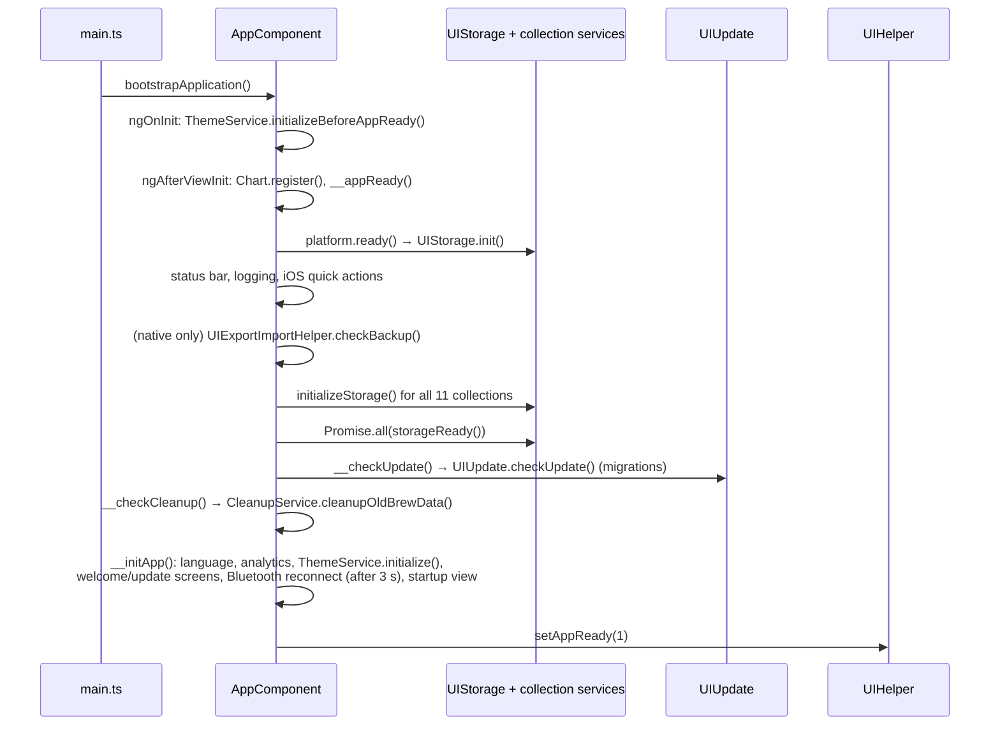
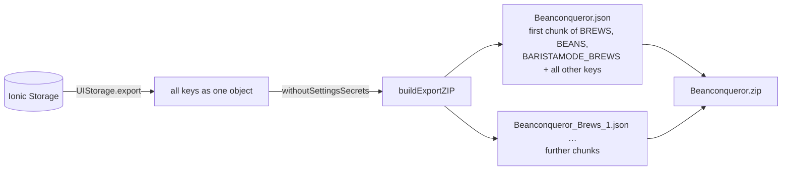
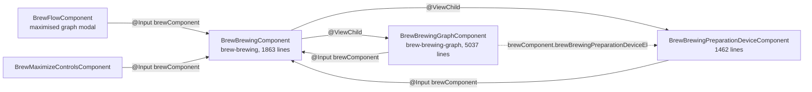

# Beanconqueror Architecture

This document describes how the app is built today, which parts are known to be
hard to change, and the rules that new code follows. Every statement names the
files it is based on; if the code and this document disagree, the code wins and
this document needs an update.

Contents:

1. [Overview](#1-overview)
2. [Data](#2-data)
3. [Devices](#3-devices)
4. [UI layer](#4-ui-layer)
5. [Known legacy areas](#5-known-legacy-areas)
6. [Target picture for new code](#6-target-picture-for-new-code)
7. [Testing rules](#7-testing-rules)

## 1. Overview

### Platform and stack

| Concern          | Choice                                                                  | Where                                                                            |
| ---------------- | ----------------------------------------------------------------------- | -------------------------------------------------------------------------------- |
| Framework        | Angular 21, standalone components, bootstrapped without NgModules       | `package.json`, `src/main.ts`                                                    |
| UI kit           | Ionic 8, `md` mode on every platform (iOS included)                     | `src/main.ts` (`provideIonicAngular({ mode: 'md' })`)                            |
| Native shell     | Capacitor 8 (Android, iOS), plus a few Cordova plugins (BLE, NFC)       | `capacitor.config.ts`, `package.json`                                            |
| Storage          | Ionic Storage (IndexedDB first)                                         | `src/main.ts`, `src/services/uiStorage.ts`                                       |
| i18n             | ngx-translate, JSON files per language                                  | `src/main.ts`, `src/assets/i18n/`                                                |
| Charts           | Chart.js                                                                | `src/app/app.component.ts` (`Chart.register`)                                    |
| Change detection | zone.js (`provideZoneChangeDetection()`)                                | `src/main.ts`, `src/polyfills.ts`                                                |
| Tooling          | pnpm, ESLint (with a suppressions ratchet), Prettier, Karma, Playwright | `package.json`, `eslint.config.mjs`, `src/karma.conf.js`, `playwright.config.ts` |

### Start sequence

`src/main.ts` registers the providers (storage driver order, router, translations
with `en` as default and fallback, Ionic in `md` mode, the global
`BeanconquerorErrorHandler`) and bootstraps `AppComponent`
(`src/app/app.component.ts`). The component then runs the following steps:



Routes wait for this: every top-level route carries the `appReady` resolver,
which resolves once `UIHelper.isBeanconqurorAppReady()` sees the ready flag
(`src/app/app.routes.ts`, `src/services/uiHelper.ts`). Code that runs outside a
route (services, quick actions) waits on the same promise.

If one collection fails to load, the app shows a blocking error message
(`UIAlert.showAppShetItSelfMessage()` in `__appReady`).

### Routing and navigation

```
/                         → redirect to /home/dashboard
/home                     HomePage (eager), ion-tabs with four tabs
  /home/dashboard         Home
  /home/brews             Brews
  /home/beans             Beans
  /home/profile           Profile hub
  /home/profile/preparations   preparation methods (in the profile tab's stack)
  /home/profile/mills          grinders (in the profile tab's stack)
  /home/preparations, /home/mills   redirects kept for old links
/settings, /statistic, /water-section, /roasting-section, /graph-section,
/helper, /info, /brew-parameter, /bean-parameter, /baristamode   (lazy)
```

- Tabs: `src/app/home/home.page.html`, child routes in `src/app/home/home.routes.ts`.
- Top-level routes are lazy (`loadComponent`/`loadChildren`) except `/home`
  (`src/app/app.routes.ts`).
- The profile tab (`src/app/profile/profile.page.*`) is a hub that links to the
  sections that are not tabs of their own: preparation methods, grinders, water
  (only when the water section is switched on), statistics and settings.
- The side menu (`ion-menu` in `src/app/app.component.html`) still exists and
  lists the optional sections; `AppComponent.setUIParams()` decides which of
  them are visible from the settings.
- Most create, edit and detail screens are modals opened through helper services
  (for example `src/services/uiBrewHelper.ts`, `src/services/uiBeanHelper.ts`),
  not routes.

### Folder structure

| Folder                         | Content                                                                                     |
| ------------------------------ | ------------------------------------------------------------------------------------------- |
| `src/app/`                     | Pages and the components that belong to one page (e.g. `src/app/brew/brew-add/`)            |
| `src/components/`              | Components shared between pages (cards, brew form parts, header, timer)                     |
| `src/popover/`                 | Popovers and small modals (welcome, update, loading, device chooser)                        |
| `src/classes/`                 | Data model classes (`Bean`, `Brew`, `Settings`, …), device drivers, `StorageClass`          |
| `src/interfaces/`              | `I*` interfaces of the stored data model                                                    |
| `src/enums/`                   | Enums used by the data model and the UI                                                     |
| `src/services/`                | Storage services (`ui*Storage.ts`), helpers (`ui*Helper.ts`), platform and feature services |
| `src/pipes/`, `src/directive/` | Pipes and directives                                                                        |
| `src/data/`                    | Static data (cupping flavors, default graph colors, tracking names)                         |
| `src/theme/`                   | Global theme: `variables.scss` (Ionic palette), `bq-tokens.scss` (design tokens)            |
| `src/native/`                  | Typed bridges to the app's own native plugins                                               |
| `src/generated/`               | Generated code (icon registry, protobuf); do not edit by hand                               |
| `src/test-utils/`              | Shared helpers and mocks for unit tests                                                     |
| `e2e/`                         | Playwright tests, fixtures and the axe baseline                                             |
| `tools/`                       | Build and release scripts                                                                   |

### Conventions

- Component and directive selectors use the `app` prefix (`eslint.config.mjs`);
  older code does not always follow it, which is why the rule is a warning.
- ESLint errors that already existed are recorded in `eslint-suppressions.json`;
  the file may only shrink (`DEVELOPING.md`).
- Formatting and import order come from Prettier (`package.json`, `prettier`),
  run on staged files by lint-staged.
- Unit tests live in a `__tests__` folder next to the code they test
  (e.g. `src/classes/settings/__tests__/`).
- Dependencies are injected with `inject()`. Several legacy services also expose
  a static `instance` or `getInstance()` for code that cannot inject
  (e.g. `src/services/uiBeanStorage.ts`, `src/services/uiAlert.ts`).

## 2. Data

### Storage layer

```
Component / helper service
        │
        ▼
UIBeanStorage, UIBrewStorage, …      (src/services/ui*Storage.ts)
        │  extends
        ▼
StorageClass                         (src/classes/storageClass.ts)
   in-memory array of all entries, add/update/remove, events
        │
        ▼
UIStorage                            (src/services/uiStorage.ts)
   get/set by key with retries, export/import, STORAGE_CHANGED event
        │
        ▼
@ionic/storage  ─ driver order: IndexedDB → Cordova SQLite → localStorage   (src/main.ts)
   database name "__baristaDB"
```

- Each collection is **one key** that holds **one array** with all its entries.
  `StorageClass` loads the array once at start (`__initializeStorage`) and keeps
  it in memory; every `add`, `update` and `remove` writes the whole array back
  (`__save` → `UIStorage.set(DB_PATH, storedData)`).
- New entries get `config.uuid` (`crypto.randomUUID()`) and
  `config.unix_timestamp` in `StorageClass.addAndConfirm`.
- `StorageClass.attachOnEvent()` emits `ADD`, `UPDATE`, `REMOVE` and
  `REINITIALIZE`. Services that cache class instances (e.g. `UIBeanStorage.getAllEntries()`
  builds `Bean` objects with `initializeByObject`) clear the cache on every event.
- `UIStorage.set` and `UIStorage.get` retry up to 20 times, reconnect the
  database after 11 failed attempts and finally show the iOS database error
  dialog. A successful `set` dispatches `AppEventType.STORAGE_CHANGED`
  on the `EventQueueService`.

### Collections

| Storage key         | Service                                    | Model class                                        |
| ------------------- | ------------------------------------------ | -------------------------------------------------- |
| `BEANS`             | `src/services/uiBeanStorage.ts`            | `src/classes/bean/bean.ts`                         |
| `BREWS`             | `src/services/uiBrewStorage.ts`            | `src/classes/brew/brew.ts`                         |
| `PREPARATION`       | `src/services/uiPreparationStorage.ts`     | `src/classes/preparation/preparation.ts`           |
| `MILL`              | `src/services/uiMillStorage.ts`            | `src/classes/mill/mill.ts`                         |
| `GREEN_BEANS`       | `src/services/uiGreenBeanStorage.ts`       | `src/classes/green-bean/green-bean.ts`             |
| `ROASTING_MACHINES` | `src/services/uiRoastingMachineStorage.ts` | `src/classes/roasting-machine/roasting-machine.ts` |
| `WATER`             | `src/services/uiWaterStorage.ts`           | `src/classes/water/water.ts`                       |
| `GRAPH`             | `src/services/uiGraphStorage.service.ts`   | `src/classes/graph/graph.ts`                       |
| `BARISTAMODE_BREWS` | `src/services/uiBaristamodeBrewStorage.ts` | `src/classes/brew/baristamodeBrew.ts`              |
| `SETTINGS`          | `src/services/uiSettingsStorage.ts`        | `src/classes/settings/settings.ts`                 |
| `VERSION`           | `src/services/uiVersionStorage.ts`         | `src/classes/version/` (applied migrations)        |

Most collections have a matching `ui*Helper.ts` service that opens the add,
edit and detail modals and holds shared logic (e.g. `src/services/uiBrewHelper.ts`).

The stored shape is part of the backup format: older backups are imported as
they are and migrated on the next start (see below), so fields are not renamed
or removed.

### Settings

`SETTINGS` holds exactly one entry. `UISettingsStorage` creates it on first
start and returns it as a `Settings` instance through `getSettings()`
(`src/services/uiSettingsStorage.ts`, `src/classes/settings/settings.ts`).
Settings that hold credentials are listed in
`src/classes/settings/settingsSecrets.ts` (see backups).

### Files on the file system

Large or binary data does not live in the database but in the app's data
directory (`UIFileHelper.getDataDirectory()`: `Documents` on iOS, `Data` on
Android, `src/services/uiFileHelper.ts`). The database only stores the path.

- Photos: `attachments` arrays on beans, brews and other entries; files are
  written through `src/services/uiImage.ts` with
  `UIFileHelper.generateInternalPath()`.
- Flow profiles (scale, pressure and temperature readings of a brew):
  `brews/<uuid>_flow_profile.json`, written by
  `src/components/brews/brew-brewing/brew-brewing.component.ts`; imported
  reference graphs live under `importedGraph/` (`Brew.getGraphPath()` in
  `src/classes/brew/brew.ts`).

In the browser there is no data directory; `getDataDirectory()` throws and the
graph code reads bundled sample flow profiles instead (see section 3).

### Backup, export and import



- `UIExportImportHelper.buildExportZIP()` (`src/services/uiExportImportHelper.ts`)
  exports all keys, empties the credential fields and splits `BREWS` and `BEANS`
  into chunks of 500 and `BARISTAMODE_BREWS` into chunks of 250 entries
  (`EXPORT_CHUNKING_CONFIG`). The first chunk stays in `Beanconqueror.json`.
- `getJSONFromZIPArrayBufferContent()` reads the main file and appends the
  chunk files in order.
- `UIStorage.import()` (`src/services/uiStorage.ts`) first exports the current
  data as a safety backup, then writes every imported key. If that fails, it
  writes the safety backup back. Credentials already on the device are kept
  (`withDeviceSettingsSecrets`).
- Credential filter: `SETTINGS_SECRET_PATHS` in
  `src/classes/settings/settingsSecrets.ts` lists the fields (Visualizer login,
  cloud AI key, brew-by-weight webhook credentials). They stay in the file with
  an empty value so the format does not change.
- Automatic backups: on Android and iOS, `AndroidPlatformService` and
  `IosPlatformService` listen to `STORAGE_CHANGED` with a 3 s debounce and call
  `saveAutomaticBackups()`, which writes `Beanconqueror.zip` into the data
  directory and a dated copy under `Download/Beanconqueror_export/`; the
  copies are removed after seven days
  (`src/services/androidPlatform/android-platform.service.ts`,
  `src/services/iosPlatform/ios-platform.service.ts`).
- At start (native only), `checkBackup()` reads a single file: the internal
  `Beanconqueror.zip` in the data directory, or the legacy `Beanconqueror.json`
  when there is no ZIP (`readBackupZIPFile`). Despite its name,
  `__getBiggerFileBackupOrAutomatic` compares nothing: the comparison with the
  dated copies is commented out and `isAutomaticBackup` is always `false`. In
  `checkBackupAndSeeIfDataAreCorrupted`, an empty database imports the file
  directly; otherwise the data corruption dialog offers the file when it holds
  more beans, brews, preparations or grinders than the database.
- Photos and flow profiles are not part of the ZIP. On Android, the manual
  export in settings copies them next to it (`exportToPath` in
  `src/app/settings/settings.page.ts`); on iOS the data directory is visible to
  the user.

### Start migrations

`UIUpdate.checkUpdate()` (`src/services/uiUpdate.ts`) runs the data migrations
`UPDATE_1` … `UPDATE_15` in order. A migration that succeeds is recorded in the
`VERSION` entry (`Version.pushUpdatedDataVersion`) and does not run again. If
`__updateDataVersion()` returns `false` or throws, nothing is recorded and the
migration runs again on the next start (`__checkUpdateForDataVersion`). When
`UIStorage.hasData()` is false and a migration is pending, a loading spinner is
shown while they run; with existing data they run without it.

A new migration touches three places in `src/services/uiUpdate.ts`: the
`updateVersions` array in `checkUpdate()`, the chain of
`__checkUpdateForDataVersion('UPDATE_n', …)` calls below it, and a new `case`
in `__updateDataVersion()`. Existing migrations are not changed, because
installations and imported backups can be at any older state.

## 3. Devices

### Bluetooth

`CoffeeBluetoothDevicesService`
(`src/services/coffeeBluetoothDevices/coffee-bluetooth-devices.service.ts`)
wraps the Cordova plugin `cordova-plugin-ble-central` (global `ble`). It scans,
connects, reconnects and holds at most one device per type:

| Type (`BluetoothTypes`) | Drivers                                                         | Factory                     |
| ----------------------- | --------------------------------------------------------------- | --------------------------- |
| `SCALE`                 | 21 scales (`ScaleType`), e.g. Acaia, Decent, Felicita, Timemore | `makeDevice()`              |
| `PRESSURE`              | 5 sensors (`PressureType`)                                      | `makePressureDevice()`      |
| `TEMPERATURE`           | 13 thermometers (`TemperatureType`)                             | `makeTemperatureDevice()`   |
| `TDS`                   | DiFluid R2 refractometer (`RefractometerType`)                  | `makeRefractometerDevice()` |

Types and factories: `src/classes/devices/types.ts`, `src/classes/devices/index.ts`;
one driver class per device in `src/classes/devices/`. The ids of the paired
devices are settings (`scale_id`, `pressure_id`, `temperature_id`,
`refractometer_id`); `AppComponent.__initApp()` reconnects them three seconds
after start.

### Preparation devices (machines)

A preparation method can be linked to a machine
(`Preparation.connectedPreparationDevice`, `src/classes/preparation/preparation.ts`).
`makePreparationDevice()` (`src/classes/preparationDevice/index.ts`) creates the
driver: Xenia, Meticulous, Sanremo YOU, Gaggiuino, Gaggimate (network, via
`HttpClient`) and Move2 (Bluetooth, `bluetoothPreparationDevice.ts`). The brew
form uses them through
`src/components/brews/brew-brewing-preparation-device/`; shots can also be
imported from Meticulous, Gaggiuino and Gaggimate (`src/app/brew/brew-modal-import-shot-*`).

### Barista mode

`/baristamode` (`src/app/baristamode/`) is a separate interface with barista,
brews and statistics pages (`baristamode.routes.ts`) and its own collection
`BARISTAMODE_BREWS`. It appears in the
menu once an active Sanremo YOU preparation exists
(`AppComponent.checkAndActivateTheBaristaModeIfNeeded()`).

### Limits in the browser

The browser build runs as Capacitor's `web` platform, so every
`platform.is('capacitor')` branch is skipped. The brew graph
(`src/components/brews/brew-brewing-graph/brew-brewing-graph.component.ts`)
then pretends a scale is connected, generates readings on a timer when the
brew timer starts and reads bundled sample flow profiles
(`src/assets/BeanconquerorFlowTestData*.json`). Real Bluetooth, NFC, camera,
file system and machine connections need a device; `DEVELOPING.md` describes
what the Playwright native boundary (`e2e/support/native.ts`) can and cannot
stand in for.

## 4. UI layer

### Ionic

Ionic standalone components are imported per component from
`@ionic/angular/standalone`. `md` mode is forced on all platforms, ripple is off
and inputs use `useSetInputAPI` so signal inputs work in modals (`src/main.ts`).
Custom icons are registered once in `AppComponent.addAllCustomIcons()` from
`src/generated/icon-registry.ts`.

### Design tokens

`src/theme/bq-tokens.scss` is the single source for brand values. Components
use the semantic `--bq-*` custom properties (surfaces, text, actions, borders,
focus, form controls, layout widths, type scale), never palette values. The
file maps them onto Ionic's variables at the end.

- Load order (`angular.json`, `styles`): `src/global.scss`,
  `src/theme/variables.scss` (legacy Ionic palette), `src/theme/bq-tokens.scss`,
  `src/app/app.scss`. The tokens load after `variables.scss` and win over it.
- Dark mode: `ThemeService.applyTheme()` toggles the class `ion-palette-dark`
  on `<html>` (`src/services/theme/theme.service.ts`). Ionic sets its dark
  variables on `.ion-palette-dark.md` / `.ion-palette-dark.ios`, so the token
  overrides use `:root.ion-palette-dark.md, :root.ion-palette-dark.ios` to have
  at least the same specificity; light values use `:root.md, :root.ios`.
- Call-to-action colour: `$bq-action-primary` (`--bq-action-primary`) is
  applied to Ionic's custom colour `accent` (`ionic-accent` mixin and
  `.ion-color-accent`). Ionic's built-in `primary` still comes from
  `variables.scss`.

### Accessibility

- Focus ring: `--bq-focus-ring*` tokens, applied for `:focus-visible` in
  `src/app/app.scss` (double ring on coral fills).
- Headings: `<app-header [heading]="true">` exposes the screen title as the
  level-1 heading (`src/components/header/header.component.ts`); sections below
  it use real heading elements (e.g. `h2` in `src/app/profile/profile.page.html`).
- Tabs are reachable by keyboard (`src/app/home/home.page.html`).
- axe baseline: `e2e/accessibility.spec.ts` scans the main areas in light and
  dark against WCAG 2.2 AA; known violations live in
  `e2e/accessibility-baseline.json`, which may only shrink (`DEVELOPING.md`).
- `DocumentLanguageService` keeps `lang` and `dir` on `<html>` in sync with the
  app language, including right-to-left for Arabic and Hebrew
  (`src/services/documentLanguage/document-language.service.ts`).

### Typography and zoom

The type scale is in `rem` (`--bq-type-*` in `src/theme/bq-tokens.scss`), so
text follows the system text size. Inputs never go below 16 px (iOS zoom on
focus); tab labels and the screen title are capped so bar chrome does not
clip. CJK languages get system fonts first (`:root:lang(ja)` etc.). Tabular
figures are used for live readings. `e2e/typography.spec.ts` checks the layout
at 200 % text size.

### Tablet column

`TabletLayoutService` (`src/services/tabletLayout/tablet-layout.service.ts`)
sets the class `bq-tablet` on `<html>` when the shortest screen side is at least
600 px (like Android's `sw600dp`). `src/app/app.scss` then limits content to
`--bq-content-max-width` (720 px) and buttons and sheets to their own maximum
widths. Covered by `e2e/tablet.spec.ts`.

### System bars and ThemeService

`ThemeService` reads `--bq-system-bar-light` / `--bq-system-bar-dark` from the
tokens and applies the colour to the `theme-color` meta tags, the status bar
(`@capacitor/status-bar`, `SystemBars`), the Android navigation and status bar
(edge-to-edge plugin) and the iOS keyboard style. The plugins are injected
through `THEME_PLUGINS` (`src/services/theme/theme-plugins.ts`) so the service
is unit-testable. `src/index.html` and the Android resources repeat the bar
colours because they cannot read CSS. Covered by `e2e/system-bars.spec.ts`.

### i18n

- One JSON file per language in `src/assets/i18n/` (22 languages), loaded over
  HTTP by `provideTranslateHttpLoader` (`src/main.ts`).
- `en` is the default and the fallback for missing keys.
- `AppComponent.__setDeviceLanguage()` picks the stored language or the device
  language on first start.
- Translations are maintained in Lokalise and arrive as "Lokalise update" pull
  requests (see the git history of `src/assets/i18n/`).

## 5. Known legacy areas

These parts have grown with the app's features. They work and are covered by
user expectations; they are listed here because changes there need extra care.
Counts were taken with `grep` over `src/**/*.ts` (without `*.spec.ts`) and
`src/**/*.html` and are approximate.

### Coupling in the brew area

The brew form and its parts reference each other directly:



- `brewComponent` is passed as `[brewComponent]='this'` from
  `src/components/brews/brew-brewing/brew-brewing.component.html` and as a modal
  prop from `brew-brewing.component.ts` and `src/app/brew/brew-detail/brew-detail.component.ts`.
- The graph component uses `this.brewComponent` 185 times, the preparation
  device component 50 times. Timer, scale events, machine shots and the form
  data therefore change together.
- The brew form behaviour is pinned by browser tests
  (`e2e/brew-journey.spec.ts`, `e2e/brew-timer.spec.ts`,
  `e2e/brew-values.spec.ts`, `e2e/brew-parameters.spec.ts`) before it is
  restructured.

### zone.js and change detection workarounds

The app depends on zone.js for change detection (`src/polyfills.ts`,
`provideZoneChangeDetection()` in `src/main.ts`); almost all state is plain
mutable fields. Counts at the time of writing:

| Pattern                                      | Occurrences         | Files |
| -------------------------------------------- | ------------------- | ----- |
| `detectChanges()`                            | 40                  | 34    |
| `markForCheck()`                             | 6                   | 2     |
| `ngZone.run(` / `zone.run(`                  | 5                   | 3     |
| `runOutsideAngular`                          | 22                  | 5     |
| `setTimeout(` (many used to defer an update) | 188                 | 77    |
| `ChangeDetectionStrategy.OnPush`             | 1 of 163 components | 1     |
| `signal(` / `computed(`                      | 5                   | 2     |

Re-count with, for example:
`grep -rE "detectChanges\(" src --include='*.ts' --exclude='*.spec.ts' | wc -l`.

### Function calls in templates

About 240 call expressions in interpolations, property bindings and `@if` /
`@for` conditions across 53 of 159 component templates (all `src/**/*.html`
except `src/index.html`; heuristic `grep` for an
identifier followed by `(` inside `{{ }}`, `[x]="…"` and control-flow
conditions). With default change detection they run on every cycle. The
`brewFunction` and `beanFunction` pipes (`src/pipes/brew/brewFunction.ts`,
`src/pipes/bean/beanFunction.ts`) were introduced to move some of these calls
into pure pipes.

### ag-virtual-scroll

Long lists (brews, beans, preparations, grinders, water, green beans, graphs,
barista mode brews and several selection modals, 16 templates) use the
third-party `ag-virtual-scroll` (`~1.20.2`, `package.json`). It renders only the
visible rows, so list tests must scroll to reach entries, and its behaviour with
dynamic row heights (larger text, tablets) has to be checked when a list
changes.

## 6. Target picture for new code

New code, and legacy code that is being rebuilt, follows these rules. Existing
code is not changed only to satisfy them.

- **Domain logic in plain TypeScript.** Calculations, filtering, sorting and
  data access live in services or repositories without Ionic imports, so they
  can be unit tested without a DOM. Components only connect them to the UI.
- **State as signals, events as observables.** Component and service state uses
  Angular `signal()` and `computed()`; one-off events (device readings, storage
  events) stay `Observable`s and are converted at the edge (`toSignal`) where
  useful.
- **`ChangeDetectionStrategy.OnPush`** on every new component.
- **No function calls in templates for derived values.** Use `computed()` (or a
  pure pipe); event handlers like `(click)="save()"` are fine.
- **No component references through inputs.** Children receive data through
  `input()` and report through `output()`; shared state goes into a service.
- **Tokens only.** New screens style with `--bq-*` tokens and use the
  call-to-action colour through `color="accent"` (mapped to
  `--bq-action-primary`), not raw colours.
- **Standalone and `inject()`** like the rest of the app; no new static service
  instances.

`src/components/actions-popover/actions-popover.component.ts` is a small
example that already uses OnPush, signal inputs and `computed()`.

## 7. Testing rules

| Area                                                      | Rule                                                                                         |
| --------------------------------------------------------- | -------------------------------------------------------------------------------------------- |
| New code                                                  | At least 80 % of each file's statements and lines covered by unit tests (Karma/Jasmine).     |
| New screens                                               | Every user flow covered by Playwright, including an axe scan, dark mode and 200 % text size. |
| Legacy code                                               | Characterisation tests only where code is rebuilt; they pin the current behaviour first.     |
| Foundation (storage, migrations, backup/import, settings) | Every change comes with tests, regardless of size.                                           |
| Performance                                               | Within the budgets below.                                                                    |

Existing tests to extend: `src/classes/__tests__/storageClass.spec.ts`,
`src/classes/settings/__tests__/`, `src/services/__tests__/uiExportImportHelper.spec.ts`,
`src/services/__tests__/backupSecrets.spec.ts`. `UIUpdate` has no unit tests
yet; a change to a migration starts by adding them.

Browser test conventions (fixtures, native boundary, axe baseline) are described
in `DEVELOPING.md`.

### Coverage of new code

New code is listed in `NEW_CODE` at the top of `src/karma.conf.js`, as globs
relative to the repository root. `pnpm test:coverage` runs the unit tests with
coverage (CI runs it instead of `pnpm test`) and fails when a TypeScript file
matched by the list

- has less than 80 % of its statements or of its lines covered, or
- is not loaded by any unit test.

Every file has to reach the threshold on its own. Spec files, helpers in
`__tests__` folders and files without code of their own (only types or
re-exports) are not checked. Legacy code has no threshold; the overall figure in
the summary includes it. The HTML report lands in `coverage/`, which is not
committed.

Every new code structure **must** be added to the list in the commit that
creates it:

- a new folder: its glob, e.g. `'src/services/<feature>/**'`;
- a new file in a folder that is not listed: its path, e.g.
  `'src/services/theme/theme-plugins.ts'`.

An entry that matches no file fails the run as well, so a renamed or removed
folder cannot drop out of the check unnoticed. Only code under `src/` can be
listed: the test build instruments nothing else, so the test tooling in `e2e/`
and `tools/` is outside this rule.

### Performance budgets

The Pixel 2 XL is the low-end reference device. The largest known installation
has about 7,000 brews and 600 beans, so the data sets have 7,000 brews and
15,000 as headroom, each with 1,000 beans (generated by
`e2e/support/synthetic-data.ts`). `pnpm e2e:perf` checks app start, the brew
list (open and scroll to the end), search, the bean list, statistics, export and
import in an emulated Pixel 2 XL with 4x CPU throttling against
`e2e/perf/budgets.ts`. How to run it and how to measure the same flows on the
device is described in `DEVELOPING.md`. Opening the brew form is not covered
yet.
